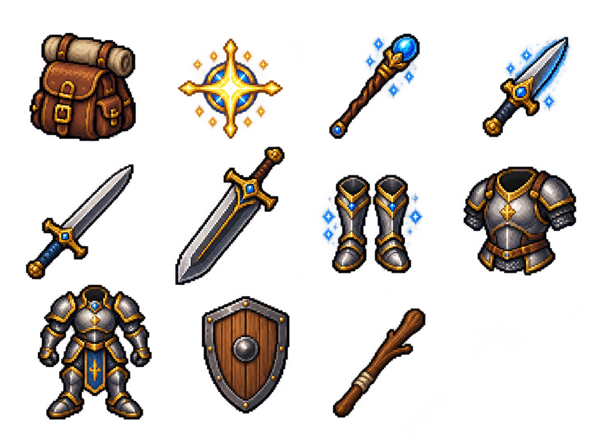

# Droppable Item Representation Table

This is the approval list for world representations. Existing atlas entries are
reused where noted. The new-art preview below is a single transparent 4-by-3
sprite sheet; the empty final cell is intentional. The approved sprites are
registered as a dedicated runtime atlas at
`rogues-dungeon/public/assets/art/game-view/items/droppable-item-sprite-sheet.png`;
the legacy 32-pixel `items-static` atlas is unchanged.

| Domain item | Source | World representation | Art status |
| --- | --- | --- | --- |
| Health Potion | Inventory consumable | Potion pickup, health frame | Reuse existing `items-static` entry |
| Mana Potion | Inventory consumable | Potion pickup, mana frame | Reuse existing `items-static` entry |
| Extra Space | Capacity item | Small capacity-bag / pack pickup | Registered atlas frame 0 |
| Heal | Ability item | Arcane star / healing sigil pickup | Registered atlas frame 1 |
| Wand | Ability item | Wand pickup | Registered atlas frame 2 |
| Dagger (Magic) | Weapon | Blue-glint dagger pickup | Registered atlas frame 3 |
| Sword | Weapon | Sword pickup | Registered atlas frame 4 |
| Two-Handed Sword | Weapon | Large two-handed sword pickup | Registered atlas frame 5 |
| Leg Armor (Magic) | Armor | Greaves pickup with blue glint | Registered atlas frame 6 |
| Chest Armor | Armor | Chest armor pickup | Registered atlas frame 7 |
| Suit of Armor | Armor | Full suit armor pickup | Registered atlas frame 8 |
| Oak Shield 03 | Weapon | Oak shield pickup | Registered atlas frame 9 |
| Wooden Stick | Weapon | Wooden stick pickup | Registered atlas frame 10 |
| Gold coin | Existing world reward | Animated coin pickup / throw | Reuse existing coin atlas entry |

All rows use the same ground shadow, depth ordering, pickup collision, and
throw-flight behavior. Health Potion, Mana Potion, and Gold coin reuse existing
art. The new sprites match the existing potion and coin pixel-art scale and
palette. Each generated level receives one seeded random item from this list;
item-test mode places one of each within 50 map units of the level start.
