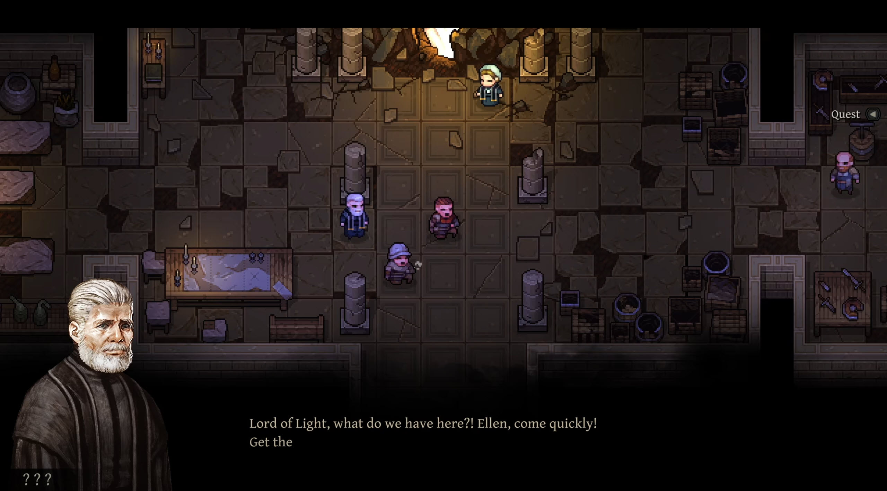
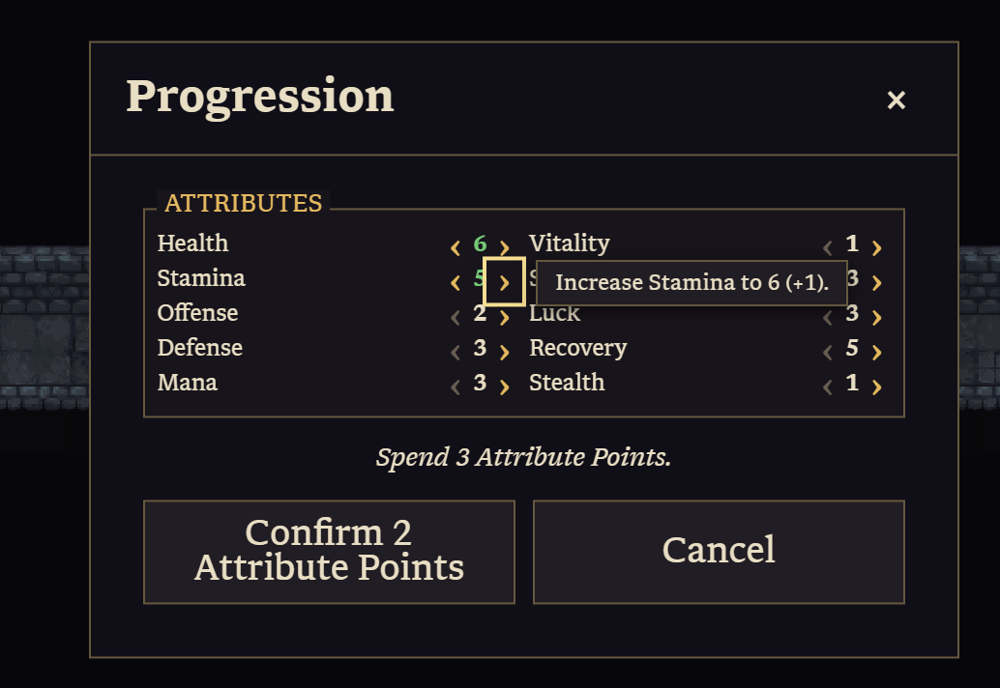

# RPG ideas

## Input, movement, and interaction

- Use this as a visual reference for character dialogue: a portrait anchored at the bottom-left, dialogue text across the lower screen, and a name label beneath the portrait.

- Show a dot on every grid cell in the walking path previewed by the mouse reticle.
- Consider custom cursors for walking, interacting, and fighting.
- Use bump interactions: bump once to show an option and bump again to accept it. Walking away declines.
- Animate the rat prompt when it appears. Slide it in from the left, stop 30 pixels before its final position, fade it in, then snap it into place.
- Add a developer toggle with three movement modes:
  - Grid-snap: move instantly between grid-cell centers.
  - Grid-tween: tween between grid-cell centers. This is the current movement behavior.
  - Gridless: move freely and stop on any whole pixel, while game logic still assigns the player to exactly one grid cell at a time.

## Kill your darlings

- Decide whether to remove the zoom controls.
- Decide whether to remove the camera modes.
- Consider making movement spend a limited resource, so every move becomes a tactical choice.

## Inventory and ability slots

- Add a vertical color strip to the left edge of every inventory item, showing the valid destination slot type for drag-and-drop.
- Use the same color on empty destination slots so players can see where an item can be dropped.
- Use purple for Ability slots, green for Quick slots, and blue for Equipment slots.
- Store the slot colors in shared constants and reuse them wherever slot types appear.
- Compare the new colors with the existing status-bar colors and adjust them if they conflict or reduce readability.

## New game and character creation

- When a player selects a new save slot, present three setup screens:
  1. Character: choose a class.
  2. Attributes: roll character statistics and allow rerolls.
  3. World: roll world-generation attributes and preview the result on a minimap.
- Decide whether to add a separate inventory-configuration screen.
- Offer three classes. Warrior and Mage are initial examples. Generate concepts for the third class with AI.
- Classes determine appearance, starting inventory, and maximum inventory capacity through an inventory item.
- Reuse the same appearance for all three classes at first.

| Starting feature | Warrior | Mage |
| --- | --- | --- |
| Abilities | None | Yes |
| Potion | Yes | Yes |
| Weapon | Yes | None |
| Armor | Armor | Light armor |

## Randomization and world generation

- Make each roll show changing values and play dice sounds.
- Reuse this roll presentation for character attributes and world generation.
- Give players 30 points to distribute across world-generation attributes.
- Include attributes such as enemy density, loot frequency, and distance to exit stairs.
- Decide the final set of about 10 world attributes or difficulty ratings.
- Drive level generation from these values.
- Update the minimap preview after every world roll.

## Mapping

- Audit the current map folders and reorganize them around their actual use.
- Identify which maps, tilesets, and supporting files are production content, test fixtures, or unused. Rename or move folders such as `examples` when they contain production content.
- Add a `prefabs` folder for reusable map fragments that generation can incorporate into a larger map.
- Support prefabs for interiors, starting areas, shop interiors, and other authored spaces.
- Treat enterable buildings as a separate feature:
  - Define the exterior and interior appearance of each building.
  - Decide whether entering a building loads a separate map or keeps one map and hides roof-covering tiles.

## Dungeon flow and world interactions

- Add an introductory story sequence.
- Add campfires. Bumping into one shows "Rest? (20 gold)."
- Resting costs 20 gold, restores health, and updates the checkpoint.
- Support NPC interactions through the shared bump-to-confirm pattern.
- Choose between two opening structures:
  - A fixed, screen-sized tutorial level where players can take the stairs immediately or explore to collect items and fight an enemy.
  - A recurring home base between levels, or one reached through campfires on every level.
- Decide whether a campfire should transport players to a separate home base.
- Add a gate to Hell guarded by a devil. The devil asks, "Enter the Gate to Hell?"
- Entering Hell loads a red-tinted version of the current level with the same art and layout, but enemies and encounters are about ten times harder.

## Progression, crafting, and upgrades

Use this progression-window reference for the attribute-allocation items below.

- Award experience points.
- Let players spend level-up points on character statistics.
- Update the attribute hover text to describe the gameplay effect without showing the raw point delta. For example, use "Decrease Health 2-5" rather than "Decrease Health 2-5 (-1)."
- Under "Spend 3 Attribute Points", add a permanent, empty three-line summary box. As points are assigned, show one plain-language line per affected attribute that totals the pending gameplay benefit. For example, health points should state the resulting maximum-health percentage increase rather than repeat "Health +1".
- Combine multiple pending points assigned to one attribute into one line showing their total effect. Show only the lines for attributes with pending changes.
- Support crafting: combine two existing items and ore to create a new item, consuming all inputs.
- Support upgrades: combine an item and ore to create the same item with improved statistics, consuming both inputs.
- For a level-up, send sparkles inward from all directions, merge them on the character, then play a chime.

## Minimap and quest tracking

- Highlight a target location on the minimap.
- When the target is inside the minimap area, show a yellow dot at its location.
- When the target is outside the minimap area, show a yellow arrow on the minimap edge pointing toward it.
- Size both indicators to about one minimap grid cell.
- Use these indicators for the selected quest subtask location.

## Menu, mobile, and presentation

- Restore mobile mode, including touch controls and responsive layout.
- Update the main menu. Make the background rise upward while fading in from black.

## Animation and special effects

- Add sprite sheets for transient particle effects that play over gameplay actions.
- Add a particle-effects system that spawns and removes short-lived groups of effect sprites.
- Add a separate special-effects system for action visuals, such as a sword-slash arc when an attack lands.
- Extend the in-game art animation system so it can tween a whole character, its main sprite, or its shadow sprite independently.
- Support programmatic effects such as flashing a target white for 0.1 seconds, then fading back to its original color.

## Dungeon content and technical work

- Use the larger dedicated bronze-chest art instead of the small atlas frame.
- Keep a test-mode chest beside the level-one entrance for quick pickup and chest testing.
- Add level editor support for tile-theme selection and editable procedural maps.
- Batch static tiles to reduce renderer RAM, CPU, and GPU work.
